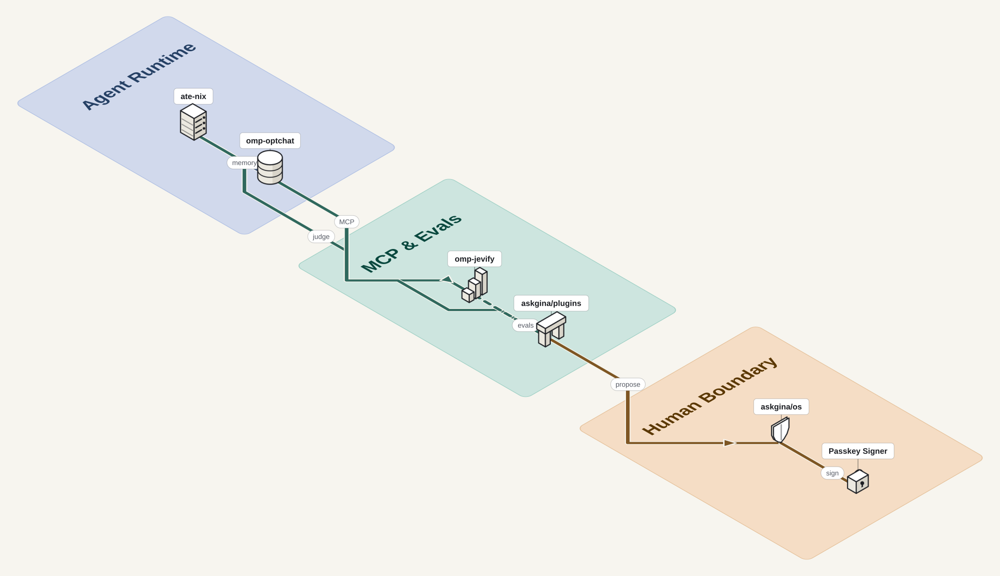

Founder & CTO at [Ask Gina](https://askgina.ai) in London — building production agents, memory, evals, and human-approved wallet boundaries.

  
   
  Drawn with <a href="https://github.com/ericjuta/isodia-mcp">isodia-mcp</a> · live eval leaderboard at <a href="https://evals.askgina.ai">evals.askgina.ai</a>

<!-- LIVE_LOG:START -->
<pre>
eric@london ~ % git log --public --latest  # updated 2026-11-20

├─ <a href="https://github.com/ericjuta/isodia-mcp">isodia-mcp</a>       <a href="https://github.com/ericjuta/isodia-mcp/commit/c11c05fc7132d058b021f024caadee3e461035fd">c11c05f</a>  today    Run Isodia natively on Cloudflare (#17)
├─ <a href="https://github.com/ericjuta/omp-optchat">omp-optchat</a>      <a href="https://github.com/ericjuta/omp-optchat/commit/6d382234b235370f3014c6c5ff7760390f91c61d">6d38223</a>  2d ago   test: honor advertised completion protocol in offli…
├─ <a href="https://github.com/ericjuta/ate-nix">ate-nix</a>          <a href="https://github.com/ericjuta/ate-nix/commit/842a797aeed17a966d7be0249a5ffb645820e858">842a797</a>  2d ago   ci: keep the Nix cache alive weekly and prune older…
├─ <a href="https://github.com/askgina/os">askgina/os</a>       <a href="https://github.com/askgina/os/commit/c87c59cbbd80db965cb9945c9e8b35e11e7fce67">c87c59c</a>  2d ago   fix: allow an agent to use the shared venue read bu…
├─ <a href="https://github.com/ericjuta/omp-jevify">omp-jevify</a>       <a href="https://github.com/ericjuta/omp-jevify/commit/eba98d7865c842106623f59f0e2d6d91112e8854">eba98d7</a>  4d ago   docs: record the two-request check that reproduced …
└─ <a href="https://github.com/askgina/plugins">askgina/plugins</a>  <a href="https://github.com/askgina/plugins/commit/d42106bc4d2c23a5eb69bc44b473c255de04d2df">d42106b</a>  17d ago  feat(antigravity): add Antigravity plugin targets f…
</pre>
<!-- LIVE_LOG:END -->

[Ask Gina](https://askgina.ai) · [Evals](https://evals.askgina.ai) · [X](https://x.com/ericjuta) · [LinkedIn](https://www.linkedin.com/in/ericjuta/)
