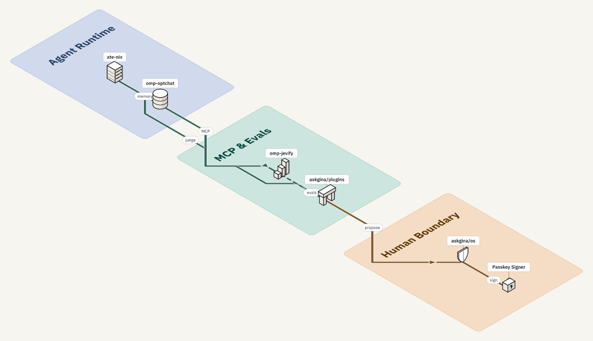

Currently building production agents, memory, evals, and human-approved wallet boundaries.

  
   
  Drawn with <a href="https://github.com/ericjuta/isodia-mcp">isodia-mcp</a> · live eval leaderboard at <a href="https://evals.askgina.ai">evals.askgina.ai</a>

<!-- LIVE_LOG:START -->
<pre>
eric@london ~ % git log --public --latest  # updated 2026-11-28

├─ <a href="https://github.com/ericjuta/omp-optchat">omp-optchat</a>      <a href="https://github.com/ericjuta/omp-optchat/commit/0a860d8b3529647cb064dd37318d4da62bda84f2">0a860d8</a>  1d ago   Release 0.16.9
├─ <a href="https://github.com/askgina/plugins">askgina/plugins</a>  <a href="https://github.com/askgina/plugins/commit/ba0c7a09c26bacb89917b2063aa127e094841b89">ba0c7a0</a>  2d ago   Merge pull request #228 from askgina/codex/evals-na…
├─ <a href="https://github.com/ericjuta/ate-nix">ate-nix</a>          <a href="https://github.com/ericjuta/ate-nix/commit/4b9e2c3db6a4cbb1dc34604ad8449f1ebc93e7aa">4b9e2c3</a>  6d ago   fix(ci): keep cache entries that the run did not do…
├─ <a href="https://github.com/ericjuta/isodia-mcp">isodia-mcp</a>       <a href="https://github.com/ericjuta/isodia-mcp/commit/4f7b266833f32b114ba5fe40918f05b183e662c2">4f7b266</a>  7d ago   Reader: WebMCP tools, per-step social cards, access…
├─ <a href="https://github.com/askgina/os">askgina/os</a>       <a href="https://github.com/askgina/os/commit/c87c59cbbd80db965cb9945c9e8b35e11e7fce67">c87c59c</a>  11d ago  fix: allow an agent to use the shared venue read bu…
└─ <a href="https://github.com/ericjuta/omp-jevify">omp-jevify</a>       <a href="https://github.com/ericjuta/omp-jevify/commit/eba98d7865c842106623f59f0e2d6d91112e8854">eba98d7</a>  13d ago  docs: record the two-request check that reproduced …
</pre>
<!-- LIVE_LOG:END -->

[Ask Gina](https://askgina.ai) · [Evals](https://evals.askgina.ai) · [X](https://x.com/ericjuta) · [LinkedIn](https://www.linkedin.com/in/ericjuta/)
